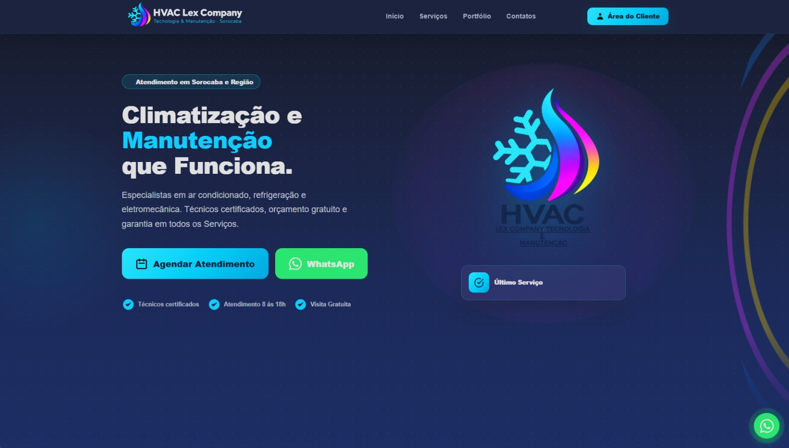
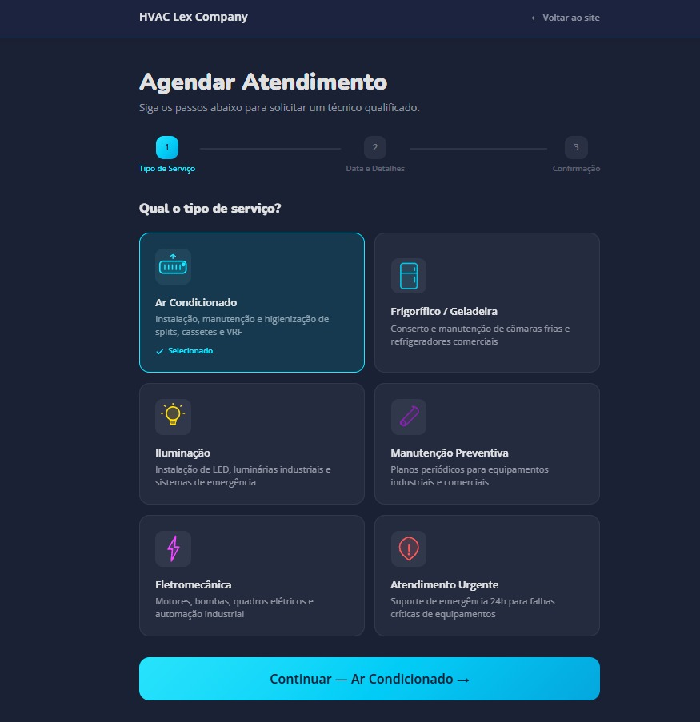
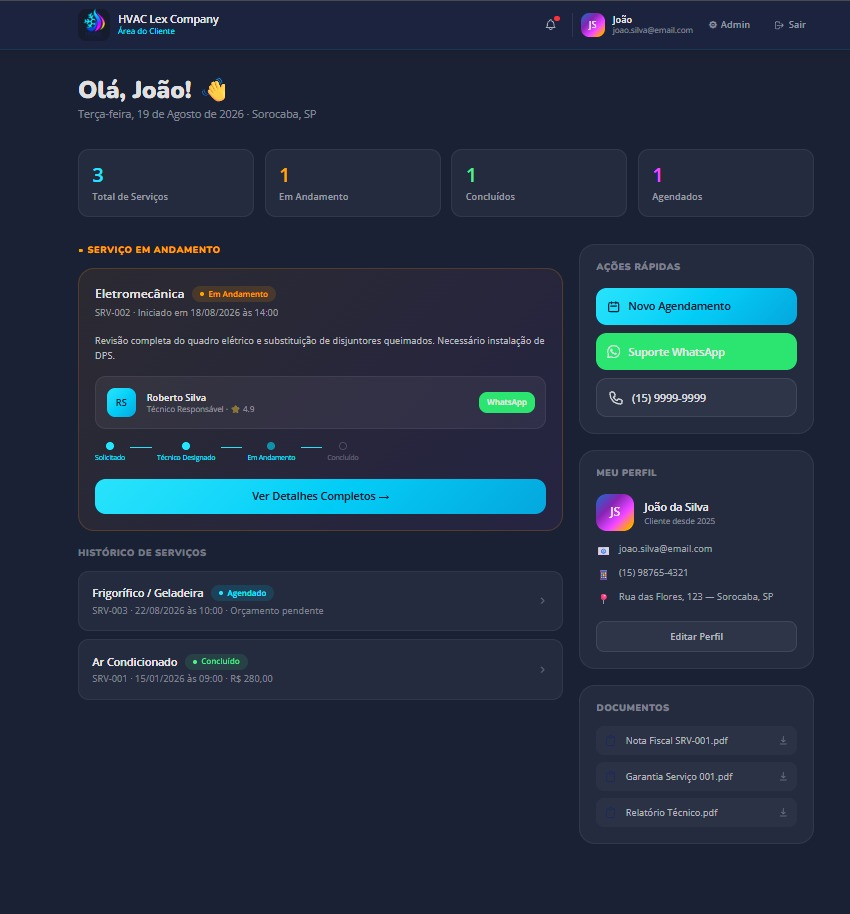
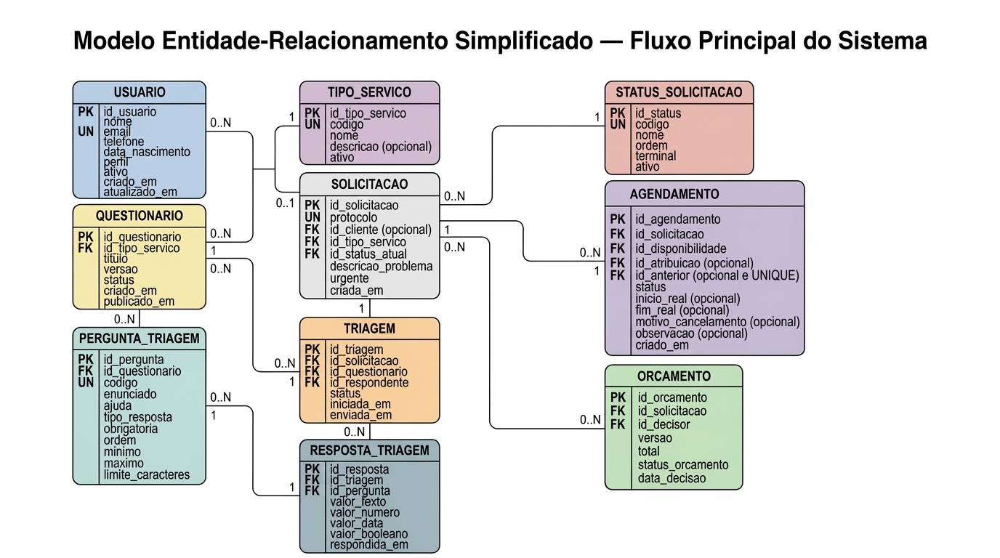

# HVAC Manutenções Sorocaba

> Site de autoatendimento com triagem guiada por serviço, solicitação e agendamento de manutenções de refrigeração e climatização.


## 📌 Sobre o projeto

Projeto de TCC do curso Técnico em Desenvolvimento de Sistemas da Etec Fernando Prestes.
A partir da entrevista realizada com o profissional da área de eletromecânica e refrigeração, identificamos a alta demanda
e o grande público-alvo que a empresa alcança. Percebemos também que todo contato com clientes era realizado via telefone e os
agendamentos eram feitos de forma manual, por ordem de chegada das mensagens. Dessa forma, nossa equipe percebeu a necessidade de
modernização do processo de atendimento, principalmente para organização da demanda e realizar divulgação dos serviços prestados.

## 🖼️ Demonstração





🔗 Site online: Indisponível (por enquanto)

## ✨ Funcionalidades

- [x] Página inicial com serviços e portfólio
- [x] Triagem guiada com 4 a 6 perguntas por tipo de serviço, salva junto ao pedido
- [x] Agendamento de atendimento
- [x] Área do cliente (login e cadastro)
- [x] Painel administrativo

| Funcionalidade            | Situação     | Observação                                       |
| ------------------------- | ------------ | ------------------------------------------------ |
| Cadastro, login e perfis  | Implementado | Cliente, e administrador                         |
| Recuperação de senha      | Implementado | Token de uso único, expira em 30 minutos         |
| Triagem                   | Implementado | Questionário e respostas persistidos             |
| Agendamento               | Implementado | Reserva com validação de capacidade              |
| Anexos do pedido          | Implementado | Upload e leitura autorizada                      |
| Início/fim do atendimento | Implementado | Registrado pelo administrador (confirma na tela) |
| Reagendamento             | Parcial      | Há campos, mas não há fluxo de criação           |
| Orçamentos                | Modelado     | Tabela sem API ou tela                           |
| Documentos                | Modelado     | Listagem sem emissão ou download                 |
| Estoque                   | Modelado     | Tabelas sem API ou tela                          |
| Avaliação                 | Modelado     | Tabela sem fluxo                                 |
| Técnicos                  | Modelado     | Trabalho futuro                                  |
| Portfólio                 | Parcial      | Depende do material da empresa                   |
| WhatsApp                  | Manual       | Link `wa.me`; não há confirmação automática      |

## 🛠️ Tecnologias

| Camada         | Tecnologias               |
| -------------- | ------------------------- |
| Frontend       | HTML, CSS e JavaScript    |
| Backend        | PHP procedural com mysqli |
| Banco de dados | MariaDB 10.4+             |
| Design         | Figma                     |

## 📁 Estrutura de pastas

```
projeto-hvac-manutencoes/
├── backend/    # API e regras de negócio
├── banco/      # Scripts SQL (criação das tabelas)
├── frontend/   # Páginas, CSS, JS e assets
└── index.html  # Página inicial
```

## 🚀 Como rodar o projeto

### 1. Preparar o ambiente

- Windows com XAMPP, ou ambiente equivalente com Apache, PHP e MariaDB.
- PHP 8.5.12 como referência do projeto e MariaDB 10.4 ou superior.
- Extensões PHP `mysqli`, `mbstring`, `fileinfo` e `openssl`.

Clone o repositório dentro da pasta `htdocs` do XAMPP e inicie o Apache e o MySQL pelo painel do XAMPP.

```bash
git clone https://github.com/mths09/projeto-hvac-manutencoes.git
```

### 2. Preparar o banco de dados

**Instalação nova.** No phpMyAdmin, crie e selecione o banco `hvac_db` com collation `utf8mb4_unicode_ci`. Importe os seguintes arquivos nesta ordem:

1. `banco/schema.sql`
2. `banco/seed.sql`
3. `banco/triagem_mvp.sql`
4. `banco/demo_horarios.sql`, se precisar de horários fictícios para demonstração.

O `schema.sql` atual já incorpora as migrations `001` a `005`. Importe a carga inicial uma única vez por banco novo.

**Migração com dados.** Exporte a estrutura e os dados do banco original e importe o dump em um banco vazio no destino. Faça backup também dos anexos e das mídias usados na instalação. Em um dump de versão anterior, compare a estrutura restaurada com `banco/migrations/` e aplique apenas as migrations pendentes, em ordem numérica. O arquivo `banco/hvac_db.sql` do repositório é um dump antigo.

#### Conta e permissões do MariaDB

O exemplo versionado usa `hvac_app` em `localhost`. Para recuperar a configuração da instalação original, confirme a conta em `backend/db_config.local.php` e execute as consultas abaixo com uma conta administrativa do MariaDB de origem. Ajuste o usuário e o host da conta conforme a instalação.

```sql
SHOW CREATE USER 'hvac_app'@'localhost';
SHOW GRANTS FOR 'hvac_app'@'localhost';
```

Os privilégios efetivos da instalação original precisam ser confirmados com essas consultas. Se a importação e as migrations forem executadas por uma conta administrativa, use o seguinte modelo para uma instalação nova e valide as operações com a conta da aplicação. Substitua o marcador por uma senha definida localmente.

```sql
CREATE USER 'hvac_app'@'localhost' IDENTIFIED BY '<SENHA_DEFINIDA_LOCALMENTE>';
GRANT SELECT, INSERT, UPDATE, DELETE ON `hvac_db`.* TO 'hvac_app'@'localhost';
SHOW GRANTS FOR 'hvac_app'@'localhost';
```

### 3. Configurar a conexão e o PHP

Copie `backend/db_config.example.php` para `backend/db_config.local.php`. Configure `host` como `localhost` quando PHP e MariaDB rodarem na mesma máquina. Preencha `usuario` e `senha` com a conta criada no destino e `banco` com `hvac_db`. O `backend/conexao.php` lê esse arquivo, usa MySQLi e aplica `utf8mb4` e o fuso `America/Sao_Paulo`.

Abra o `php.ini` usado pelo Apache, normalmente `C:\xampp\php\php.ini`. Confira as extensões carregadas, descomente as diretivas existentes quando necessário e ajuste os limites dos anexos.

```ini
extension=mysqli
extension=mbstring
extension=fileinfo
extension=openssl
file_uploads=On
upload_max_filesize=25M
post_max_size=135M
max_file_uploads=5
```

Reinicie o Apache e confira no ambiente web se os valores foram aplicados. Verifique se o PHP consegue gravar no diretório definido em `session.save_path` e nos diretórios usados para armazenar arquivos da aplicação.

### 4. Configurar o SMTP

Copie `backend/email_config.example.php` para `backend/email_config.local.php`. O envio para administradores e clientes passa por `backend/email_notificacao.php`. Quando preenchidas, as variáveis de ambiente `HVAC_*` têm precedência sobre o arquivo local.

| Campo | Configuração |
| --- | --- |
| `host` | `smtp.gmail.com` |
| `port` | `587` |
| `security` | `tls` (STARTTLS) |
| `username` | Conta Gmail que autentica no SMTP. Confirme a conta usada no destino. |
| `app_password` | Senha de app da conta Gmail, preenchida localmente. |
| `from_email` | Endereço remetente autorizado pela conta SMTP. |
| `from_name` | `HVAC Lex Company` |
| `notify_to` | Endereço administrativo que recebe o resumo de novos pedidos. Confirme a caixa de destino. |
| `app_url` | URL base da aplicação, sem barra final. Deve ser acessível no dispositivo que abrirá os links. |

O cliente recebe as mensagens no endereço cadastrado. Teste a confirmação de cadastro, as mensagens de pedido ou agendamento, a atualização de status e a recuperação de senha. Quando `app_url` usa `localhost`, os links apontam para o próprio dispositivo em que forem abertos.

Mantenha `backend/db_config.local.php` e `backend/email_config.local.php` fora do Git.

### 5. Abrir e validar a instalação

Acesse `http://localhost/projeto-hvac-manutencoes/index.html`. Ajuste o endereço se a pasta ou a porta do Apache forem diferentes. Para habilitar o login com Google, execute `composer install` na raiz e confira `backend/google_config.php` e as URLs autorizadas para o ambiente.

- [ ] **Banco e agendamento.** Confira a conexão com a conta da aplicação, os serviços, a triagem e os horários. Registre um pedido de teste e confira os dados no banco.
- [ ] **Contas e login.** Teste credenciais inválidas e confirme que cliente e administrador são encaminhados a `dashboard.html` e `tela-adm.html`, respectivamente. Em banco novo no Windows, confirme como o administrador inicial será provisionado. O script `backend/criar_admin_inicial.php` exige um terminal Linux interativo.
- [ ] **Sessões.** Use a logo na página de perfil para voltar à página inicial e confira se a sessão permanece ativa. Abra “Área do Cliente” ou “Área do Admin” e verifique o retorno à área correta. Teste também o logout e a expiração da sessão.
- [ ] **Permissões e arquivos.** Confira o bloqueio das APIs administrativas para visitantes e clientes. Valide que cada cliente só acessa seus próprios pedidos e anexos e que o upload funciona na instalação.
- [ ] **E-mails.** Confirme o resumo na caixa administrativa, as mensagens na caixa do cliente e o funcionamento dos links com a URL do destino.

## 🗄️ Banco de dados

- 

## 📚 Documentação do TCC

- Documento do TCC em elaboração.
- [Protótipo no Figma](https://www.figma.com/make/QtVjMRvK3UgsJOS3mn42eH/HVAC-Manuten%C3%A7%C3%B5es?t=eD4SLxn2nSGH2H4u-1)

## 🗺️ Próximos passos

- [ ] Adicionar Chatbot com IA para responder dúvidas rapidamente
- [ ] Hospedar o site

## 👥 Autores

| Nome        | GitHub                                                     |
| ----------- | ---------------------------------------------------------- |
| [Matheus]   | [@mths09](https://github.com/mths09)                       |
| [Lucas]     | [@lukkas-dev](https://github.com/lukkas-dev)               |
| [Guilherme] | [@Guilherme-Dev1908](https://github.com/Guilherme-Dev1908) |

## 📄 Licença

Projeto acadêmico. Todos os direitos reservados.
