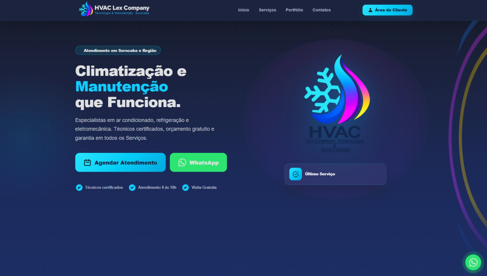
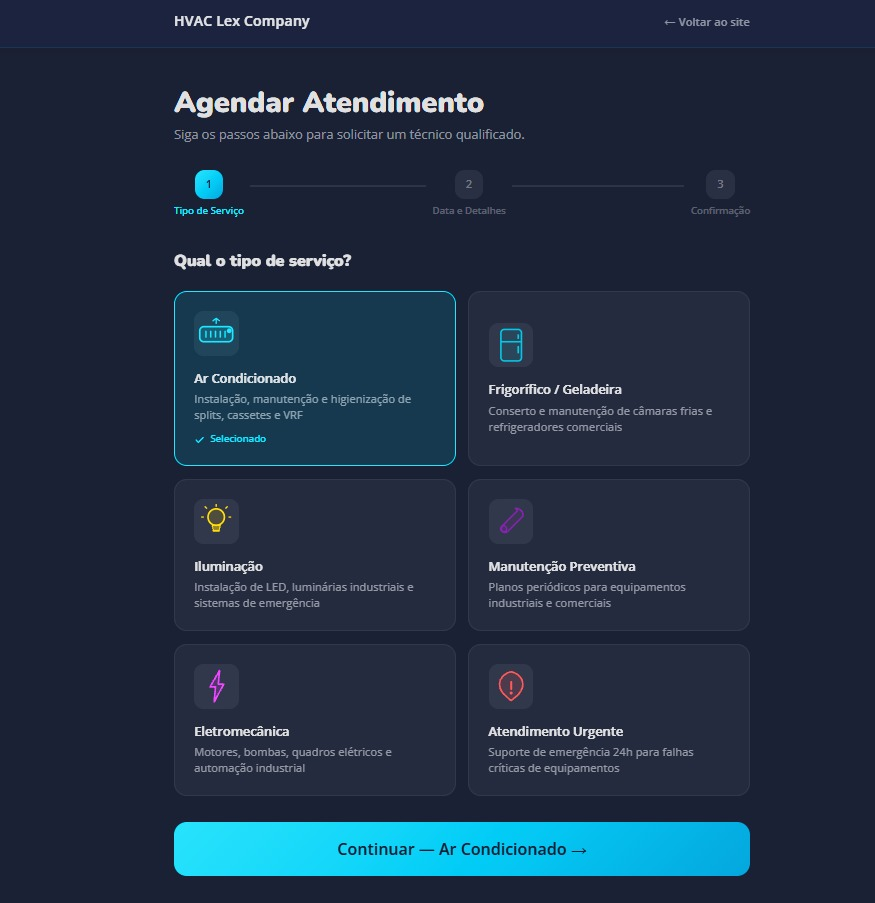
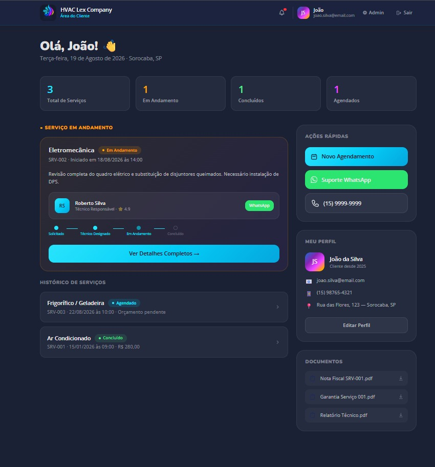
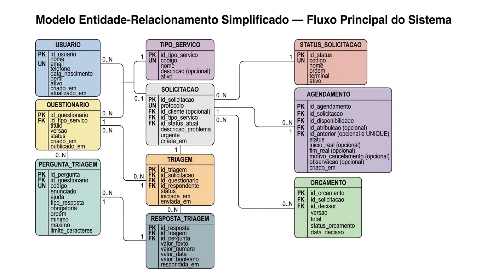

# HVAC Manutenções Sorocaba

> Site de autoatendimento para triagem, solicitação e agendamento de manutenções de refrigeração e climatização.


## 📌 Sobre o projeto

Projeto de TCC do curso Técnico em Desenvolvimento de Sistemas da Etec Fernando Prestes.
A partir da entrevista realizada com o profissional da área de eletromecânica e refrigeração, identificamos a alta demanda
e o grande público-alvo que a empresa alcança. Percebemos também que todo contato com clientes era realizado via telefone e os
agendamentos eram feitos de forma  manual, por ordem de chegada das mensagens. Dessa forma, nossa equipe percebeu a necessidade de
modernização do processo de atendimento, principalmente para organização da demanda e realizar divulgação dos serviços prestados. 

## 🖼️ Demonstração





🔗 Site online: Indisponível (por enquanto)

## ✨ Funcionalidades

- [x] Página inicial com serviços e portfólio
- [x] Triagem por tipo de equipamento
- [x] Agendamento de atendimento
- [x] Área do cliente (login e cadastro)
- [x] Painel administrativo
- [x] Confirmação por WhatsApp

## 🛠️ Tecnologias

| Camada   | Tecnologias                    |
| -------- | ------------------------------ |
| Frontend | HTML, CSS e JavaScript         |
| Backend  | PHP + Laravel                  |
| Banco    | MySQL                          |
| Design   | Figma                          |

## 📁 Estrutura de pastas

```
projeto-hvac-manutencoes/
├── backend/    # API e regras de negócio
├── banco/      # Scripts SQL (criação das tabelas)
├── frontend/   # Páginas, CSS, JS e assets
└── index.html  # Página inicial
```

## 🚀 Como rodar o projeto

### Pré-requisitos
- [PHP 8+]
- [MySQL 8+]
- Git

### Passo a passo

```bash
# 1. Clonar o repositório
git clone https://github.com/mths09/projeto-hvac-manutencoes.git
cd projeto-hvac-manutencoes

# 2. Criar o banco de dados
# execute o script da pasta banco/ no MySQL

# 3. Configurar variáveis de ambiente
cd backend
cp .env.example .env   # preencha com os seus dados
```

Acesse em `http://localhost:[porta]`.

## 🗄️ Banco de dados

- 

## 📚 Documentação do TCC

- [Documento completo do TCC](docs/Projeto_TCC_HVAC.pdf)
- [Protótipo no Figma](https://www.figma.com/make/QtVjMRvK3UgsJOS3mn42eH/HVAC-Manuten%C3%A7%C3%B5es?t=eD4SLxn2nSGH2H4u-1)

## 🗺️ Próximos passos

- [ ] Ideia Futura: adicionar Chatbot com IA para esclarecer dúvidas
- [ ] Hospedar o site

## 👥 Autores

| Nome | GitHub |
| ---- | ------ |
| [Matheus] | [@mths09](https://github.com/mths09) |
| [Lucas] | [@lukkas-dev](https://github.com/lukkas-dev) |
| [Guilherme] | [@Guilherme-Dev1908](https://github.com/Guilherme-Dev1908) |


## 📄 Licença

Projeto acadêmico. Todos os direitos reservados.
