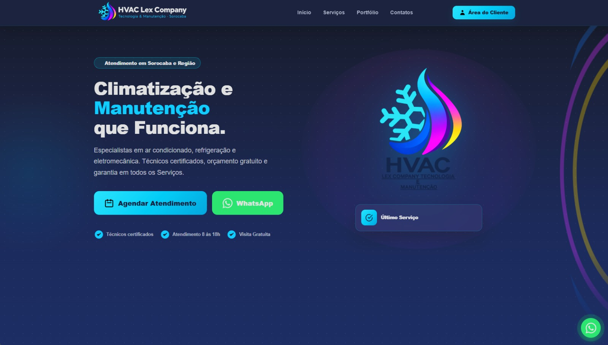
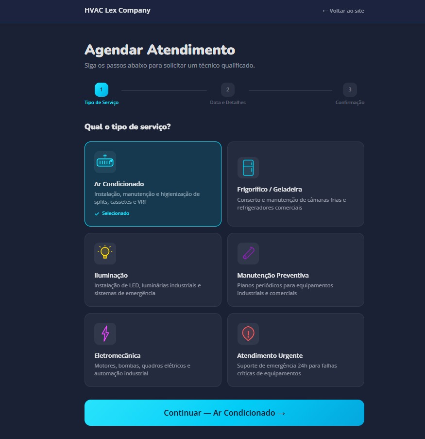
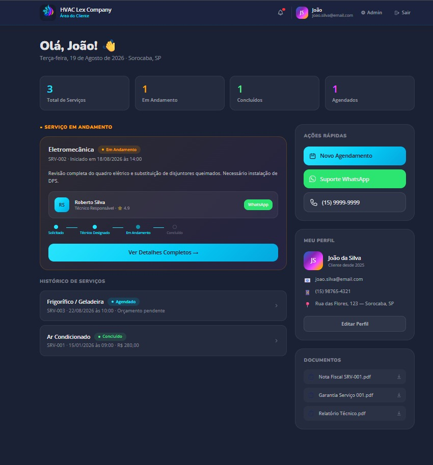
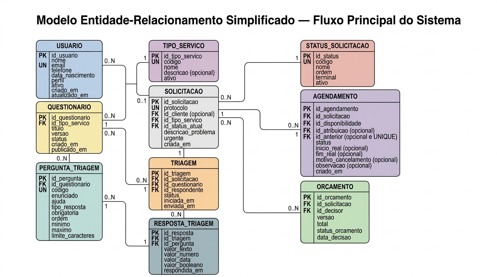

# HVAC Manutenções Sorocaba

> Site de autoatendimento com triagem guiada por serviço, solicitação e agendamento de manutenções de refrigeração e climatização.


## 📌 Sobre o projeto

Projeto de TCC do curso Técnico em Desenvolvimento de Sistemas da Etec Fernando Prestes.
A partir da entrevista realizada com o profissional da área de eletromecânica e refrigeração, identificamos a alta demanda
e o grande público-alvo que a empresa alcança. Percebemos também que todo contato com clientes era realizado via telefone e os
agendamentos eram feitos de forma manual, por ordem de chegada das mensagens. Dessa forma, nossa equipe percebeu a necessidade de
modernização do processo de atendimento, principalmente para organização da demanda e realizar divulgação dos serviços prestados.

## 🖼️ Demonstração





🔗 Site online: Indisponível (por enquanto)

## ✨ Funcionalidades

- [x] Página inicial com serviços e portfólio
- [x] Triagem guiada com 4 a 6 perguntas por tipo de serviço, salva junto ao pedido
- [x] Agendamento de atendimento
- [x] Área do cliente (login e cadastro)
- [x] Painel administrativo

| Funcionalidade            | Situação     | Observação                                       |
| ------------------------- | ------------ | ------------------------------------------------ |
| Cadastro, login e perfis  | Implementado | Cliente, e administrador                         |
| Recuperação de senha      | Implementado | Token de uso único, expira em 30 minutos         |
| Triagem                   | Implementado | Questionário e respostas persistidos             |
| Agendamento               | Implementado | Reserva com validação de capacidade              |
| Anexos do pedido          | Implementado | Upload e leitura autorizada                      |
| Início/fim do atendimento | Implementado | Registrado pelo administrador (confirma na tela) |
| Reagendamento             | Parcial      | Há campos, mas não há fluxo de criação           |
| Orçamentos                | Modelado     | Tabela sem API ou tela                           |
| Documentos                | Modelado     | Listagem sem emissão ou download                 |
| Estoque                   | Modelado     | Tabelas sem API ou tela                          |
| Avaliação                 | Modelado     | Tabela sem fluxo                                 |
| Técnicos                  | Modelado     | Trabalho futuro                                  |
| Portfólio                 | Parcial      | Depende do material da empresa                   |
| WhatsApp                  | Manual       | Link `wa.me`; não há confirmação automática      |

## 🛠️ Tecnologias

| Camada         | Tecnologias               |
| -------------- | ------------------------- |
| Frontend       | HTML, CSS e JavaScript    |
| Backend        | PHP procedural com mysqli |
| Banco de dados | MariaDB 10.4+             |
| Design         | Figma                     |

## 📁 Estrutura de pastas

```
projeto-hvac-manutencoes/
├── backend/    # API e regras de negócio
├── banco/      # Scripts SQL (criação das tabelas)
├── frontend/   # Páginas, CSS, JS e assets
└── index.html  # Página inicial
```

## 🚀 Como rodar o projeto

### Pré-requisitos

- Windows com XAMPP, ou ambiente equivalente com Apache e MySQL/MariaDB
- PHP 8.1 ou superior
- MariaDB 10.4 ou superior
- Git
- Extensões PHP: `mysqli`, `mbstring`, `fileinfo` e `openssl`

### Instalação local

1. Clone o repositório dentro da pasta `htdocs` do XAMPP:

   ```bash
   git clone https://github.com/mths09/projeto-hvac-manutencoes.git
   ```

2. Inicie o Apache e o MySQL pelo painel do XAMPP.

3. No phpMyAdmin, crie um banco vazio chamado `hvac_db`, usando a collation `utf8mb4_unicode_ci`.

4. Selecione o banco `hvac_db` e importe os arquivos nesta ordem:
   1. `banco/schema.sql`
   2. `banco/seed.sql`
   3. `banco/triagem_mvp.sql`
   4. `banco/demo_horarios.sql`
   5. Os arquivos da pasta `banco/migrations/`, em ordem numérica:
      - `001_recuperacao_senha.sql`
      - `002_aceite_politica.sql`

5. Para habilitar o envio de e-mails, copie
   `backend/email_config.example.php` para
   `backend/email_config.local.php` e configure o SMTP. Nunca envie o arquivo
   `email_config.local.php` ao Git.

6. No arquivo `C:\xampp\php\php.ini`, confira os limites para os anexos:

   ```ini
   upload_max_filesize=25M
   post_max_size=135M
   max_file_uploads=5
   ```

   Salve o arquivo e reinicie o Apache para aplicar as alterações.

7. Acesse:

   `http://localhost/projeto-hvac-manutencoes/index.html`

   Se o clone ou a pasta dentro de `htdocs` tiver outro nome, ajuste o endereço.

### Observações sobre o banco e a configuração local

- A sequência acima foi testada em um banco novo. Não a execute sobre um banco que contenha dados que você deseja preservar.
- `seed.sql` insere dados fixos iniciais. Execute-o apenas uma vez, depois de criar as tabelas.
- Execute cada migration uma vez, em ordem numérica. Se a tabela daquela migration já existir, não execute o mesmo arquivo novamente.
- `demo_horarios.sql` cria horários fictícios para demonstração. Ele pode ser executado novamente para repor horários, pois ignora os que já existem.
- `hvac_db.sql` é um dump antigo e não faz parte desta sequência de instalação.
- O link de recuperação de senha usa o endereço configurado em `app_url`. Com `localhost`, o link só abre o servidor local da máquina em que o navegador está sendo usado.
- Para usar o envio de e-mail em outra máquina, configure o SMTP e o `app_url` nessa instalação. Não compartilhe senhas SMTP no Git nem em capturas de tela.

## 🗄️ Banco de dados

- 

## 📚 Documentação do TCC

- Documento do TCC em elaboração.
- [Protótipo no Figma](https://www.figma.com/make/QtVjMRvK3UgsJOS3mn42eH/HVAC-Manuten%C3%A7%C3%B5es?t=eD4SLxn2nSGH2H4u-1)

## 🗺️ Próximos passos

- [ ] Adicionar Chatbot com IA para responder dúvidas rapidamente
- [ ] Hospedar o site

## 👥 Autores

| Nome        | GitHub                                                     |
| ----------- | ---------------------------------------------------------- |
| [Matheus]   | [@mths09](https://github.com/mths09)                       |
| [Lucas]     | [@lukkas-dev](https://github.com/lukkas-dev)               |
| [Guilherme] | [@Guilherme-Dev1908](https://github.com/Guilherme-Dev1908) |

## 📄 Licença

Projeto acadêmico. Todos os direitos reservados.
